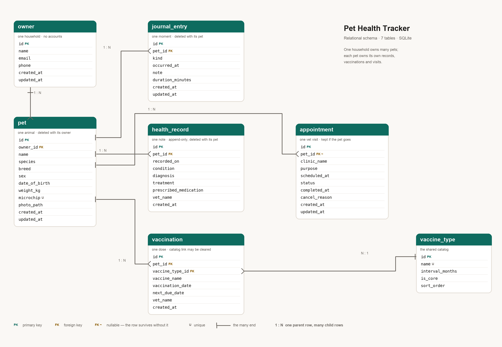
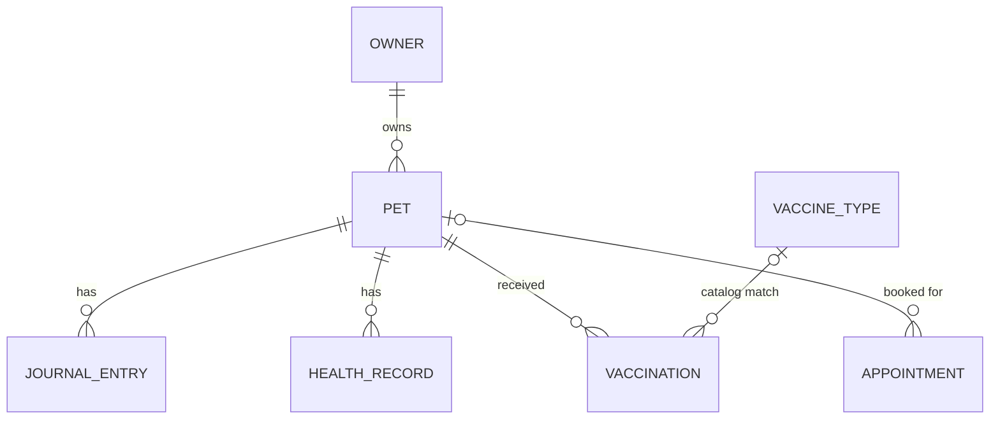

# ERD — Pet Health Tracker



Rendered by `docs/erd.py` (`python3 docs/erd.py`). The source of truth is
`db/schema.sql`; this picture describes that file, not a plan.

## Reading it

| Mark | Meaning |
| --- | --- |
| **PK** | Primary key — the column that identifies a row |
| **FK** | Foreign key — holds another table's id |
| **FK ~** | Nullable foreign key — the row survives if its parent is deleted |
| **U** | Unique (nullable: empty, or different for every row) |
| `1 : N` + crow's foot | One parent row, many child rows; the FK lives on the many side |

Delete behaviour is in each box's subtitle:

- **pet** — deleted with its owner (`ON DELETE CASCADE`)
- **journal_entry**, **health_record**, **vaccination** — deleted with their pet
- **appointment** — kept when its pet is deleted (`ON DELETE SET NULL`), because a
  visit the household still attended must not vanish
- **vaccination.vaccine_type_id** — cleared if the catalog entry goes

## The relationships

```
owner        1 ── N  pet
pet          1 ── N  journal_entry
pet          1 ── N  health_record
pet          1 ── N  vaccination
vaccine_type 1 ── N  vaccination   (nullable link)
pet          1 ── N  appointment   (nullable link)
```

Every link is one-to-many. There are no many-to-many tables because nothing here
needs a junction: a dose belongs to one pet, a visit belongs to one pet.

## Why the shapes are what they are

1. **`vaccination` stores `vaccine_name` as well as `vaccine_type_id`** — history
   must not change when the clinic renames a vaccine. The FK groups doses; the
   text is what was actually given.
2. **`appointment.pet_id` is nullable** — deleting a pet must not erase a clinic
   visit the household still needs. The visit stays, detached.
3. **Dates are `TEXT` (`YYYY-MM-DD`)** — SQLite has no date type, and ISO-8601
   text sorts and compares correctly. Instants (`scheduled_at`, `created_at`) are
   ISO-8601 UTC.
4. **`health_record` is append-only** — two triggers
   (`health_record_no_update`, `health_record_no_delete`) reject edits and
   deletes, so clinical history cannot be rewritten after the fact.

## Mermaid version (renders on GitHub)


